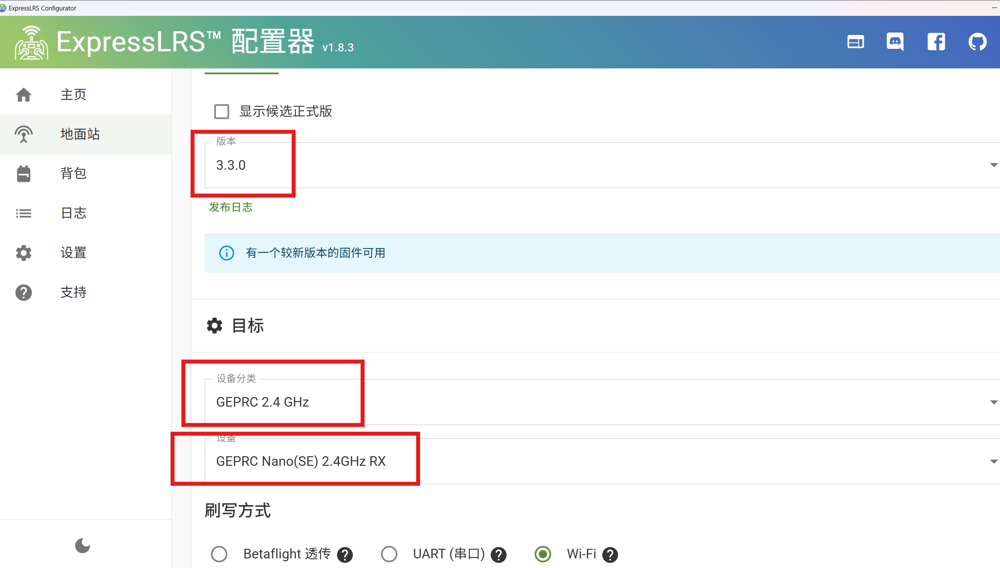
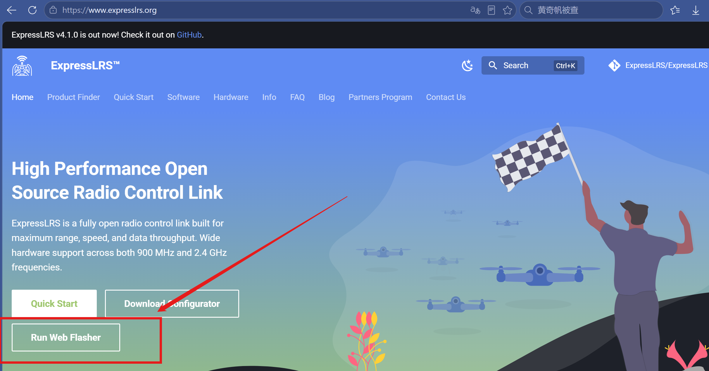

# 2026

## 10.12

1.我从"遥控器配不上"开始排查，通过官方说明书核对、接收机 WiFi 页对比、以及"能配另一台接收机的3.3.0版本固件"的对照实验，最终确认根因是接收机固件制式 `ISM2G4` 与遥控器 `CE_LBT` 不兼容，以及本固件为3.2.0；随后尝试用 Configurator 刷成 LBT，

后半夜

>   [ ExpressLRS官网](https://www.expresslrs.org/)

-   刷写固件成功

    

## 10.13

1.固件制式选错，重新进入`elrs官网`.下载`LBT`的

-   （可能跟这个没关系，是因为这个没有物理按键，而是通过快速断电三次进入绑定模式时候没弄好。理解成第四次才通电）

2.

- 格普 Nano SE 没有物理按键，通过**快速通断电 3 次**进入绑定模式：
    -   通电→立刻断电→通电→立刻断电→第三次保持通电，节奏要快
    -   指示灯出现双闪节奏，即进入绑定状态
    -   用遥控器执行绑定操作，几秒后灯常亮即成功

3.遥控器和接收机配对成功